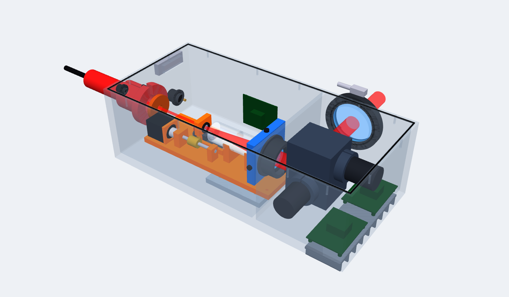

# 调焦头结构方案 v0.3（结构审查 + 优化）

> 状态：**详细结构草案**（2026-11-03）· 取代 [v0.2](调焦头结构方案_v0.2.md)（v0.2 的参考来源、子系统划分仍然适用）
> CAD：[CAD/调焦头_v0.3.step](CAD/调焦头_v0.3.step)　·　BOM：[CAD/BOM_v0.3.md](CAD/BOM_v0.3.md)（59 种）　·　3D：[在线查看](https://claude.ai/artifact/U6RcgpS4siF9UGpsYQbNPV)
> 检查：`工具/干涉检查.py` → **干涉 0 处，光路挡光 0 处**　·　重心 X = 180 mm、Y = 0、Z = 51 mm（脚本自动算）



## 1. 激光要不要准直、扩束？

要，而且两步都已经在光路里：

```
光纤（发散很快）→ 准直输出头 I01（QBH，激光器配套）→ 4 mm 平行光 → [动镜 f−30 + 物镜 f150] → 20 mm + 调焦
                  ↑ 准直                                            ↑ 扩束 ×5（调焦模块本身就是一台伽利略扩束镜）
```

- **不需要另加扩束镜**
- **准直头的输出直径决定扩束倍数**：输出 4 mm → ×5；输出 7 mm → 约 ×3（f1 换成约 −50 mm）。选激光器时一起定

## 2. 结构审查发现的问题和优化

| # | v0.2 的问题 | v0.3 的做法 | 新增 / 变化的零件 |
|---|---|---|---|
| 1 | 合束镜 + 红光模组：多一片镜、两个调节点，大功率下镜片吸热 | **去掉**；激光器选型条件加一条“**自带红光指示**”（参数 `RED_COMBINER=True` 可恢复） | −I07…I10 |
| 2 | 动镜中心高出滑座 16 mm，滑座的小角度晃动被力臂放大成横向偏移（阿贝误差） | 导轨下加 **8 mm 垫高块** | +Z22 |
| 3 | 丝杠离导轨 31 mm，推力偏载；丝杠跳动直接顶到滑座 | **电机后置**，丝杠离导轨 **20 mm**；螺母和滑座之间加**浮动接头**（只传轴向力） | +Z21，Z10–Z14 重新布置 |
| 4 | 导轨两端没有机械限位 | 加**硬限位块**（在原点 / 限位开关之后才碰到） | +Z23 |
| 5 | 保护窗正对光束，反射光会原路回到激光器 | 窗片**倾斜 3°** | W02 |
| 6 | 远距离多为户外；**上盖螺孔位置错在腔体里**（v0.2 的 bug） | 螺孔改到墙体中间；加**密封槽 + 密封条**、**防水透气阀**、窗口**吹气嘴** | +H05、H06、W04 |
| 7 | 振镜驱动板在密封壳里，热散不出去 | **导热垫** → 底板 → 外置**散热鳍片** | +G10、H07 |
| 8 | 4 个垫块在四角，离重心远，接云台不平衡 | **安装接口板**（4×M6 + 2 定位销），脚本按**重心**自动放置 | H04 改为接口板 |
| 9 | 物镜写的是双胶合，胶层在大功率下易损伤 | 改为**熔石英分离式双片 / 非球面单片** | O03 规格 |

## 3. 关键位置（v0.3）

| 项 | 值 |
|---|---|
| 壳体 | 370 × 170 × 120 mm；隔断 X = 238 |
| 光轴高 / 出光高 | 45 / 77 mm（侧面出光） |
| 动镜（对焦 ∞ / 5 m） | X = 96 / 91.95；原点开关 X = 81、限位开关 X = 107；硬限位挡住滑座在两端各留 ≥ 1.5 mm |
| 物镜 | X = 216（间距 120） |
| 导轨顶面到光轴 | 16 mm（v0.2 为 24 mm） |
| 丝杠到导轨 | 20 mm（v0.2 为 31 mm） |
| 整机包络 | 566 × 251 × 142 mm（含准直头、窗框、散热鳍片、安装板） |

## 4. 选型时要带上的新条件

- 激光器：**自带红光指示**；M² ≤ 1.2；准直头输出直径（决定 f1）
- 物镜：熔石英、非胶合
- 导轨滑块：横向晃动 ≤ 3 μm（不变）
- 浮动接头：轴向刚度高、横向柔性
